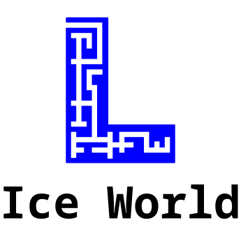

# ProjectL Ice World

A mod for Vintage Story that adds new items and crops specifically designed for the Ice World map.

## Description

ProjectL Ice World is a content mod that introduces new agricultural elements to enhance gameplay in the frozen Ice World environment. The mod adds cave wheat, a hardy crop that can grow in the stable climate of the deep caves, along with all the necessary processing items to create food and beverages.

## Features

### New Crops

- **Cave Wheat**: A cold-resistant crop that grows in stages from seeds to harvestable grain
  - Grows through 8 stages before reaching maturity
  - Can be harvested for cave wheat grain

### New Items

- **Cave Wheat Seeds**: Plantable seeds to grow new cave wheat crops
- **Cave Wheat Dough**: Processed dough ready for baking
- **Cave Wheat Flour**: Ground flour from cave wheat grain
- **Cave Wheat Bread Variants**:
  - Part-baked bread (can be cooked further)
  - Perfectly baked bread
  - Charred bread (overcooked)

### New Drinks

- **Cave Ale**: A refreshing alcoholic beverage made from cave wheat
- **Cave Whiskey**: A stronger spirit distilled from cave wheat

## Installation

1. Download the mod files
2. Add it to your mod folder

## Compatibility

- The mod works with some of the foodshelves containers the jars don't works but the floursack does.
- Designed specifically for Ice World map, but the items can be used anywhere

## Credits

- **Author**: SleepyEyes
- **Project**: Part of the ProjectL mod collection

## Version

Current version: 1.0.0

## Screenshots

## Language Support

- English (en)
- French (fr)

## Technical Details

The mod includes:

- Block types for cave wheat crop stages
- Item types for all processed goods
- Textures for visual representation
- Recipes for crafting and cooking
- Shapes for 3D models
- Patches for integration with the game

## Support

For issues or questions about ProjectL Ice World, please refer to the main ProjectL documentation or contact the author.
